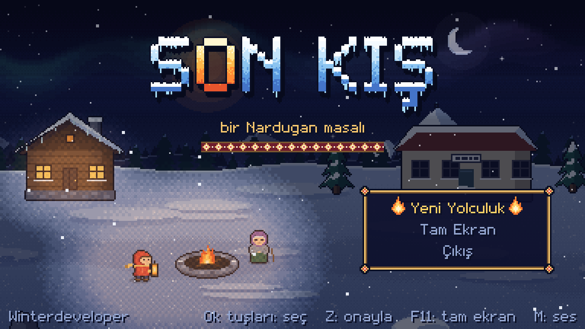
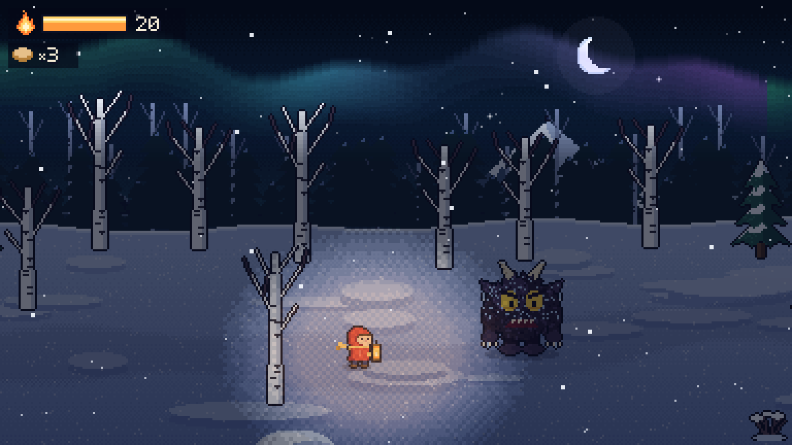
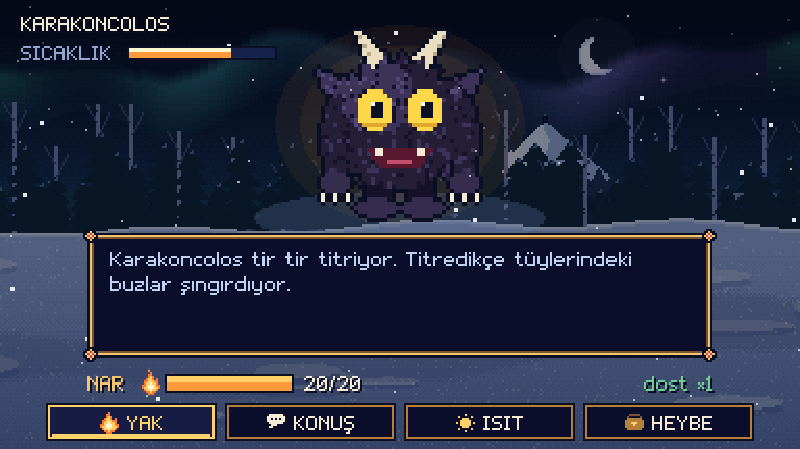

# Son Kış

*bir Nardugan masalı* — Winterdeveloper

Gün üç gündür doğmuyor. Nar, ninesinin ocağından aldığı koru fenerine koyar ve Gün Ocağı'nı yeniden yakmak için zirveye doğru yola çıkar. Yolda Anadolu ve Türk masallarının ruhları bekliyor: Karakoncolos, Telli Turna, Börü, Çarşamba Karısı, Şahmeran, Tepegöz ve zirvede Ayaz Ata.

Hepsi üşümüş. Onları **ısıtabilir** ya da **yakabilirsin**. Hangisini seçtiğin, günün nasıl doğacağını belirler.

| | |
|---|---|
|  |  |

## İndir ve oyna

1. [Releases](../../releases/latest) sayfasından `SonKis-v1.0-win64.zip` dosyasını indir.
2. Zip'i aç, `SonKis.exe` dosyasını çalıştır. Kurulum gerekmez.

Windows 10/11 (64 bit) gerekir. Windows "bilinmeyen yayıncı" uyarısı gösterirse **Ek bilgi → Yine de çalıştır** de; exe imzalı olmadığı için çıkar.

## Nasıl oynanır

| Tuş | İş |
|---|---|
| Ok tuşları | Yürü / seç |
| Z | Onayla, konuş, incele |
| X | Geri |
| M | Sesi aç / kapa |
| F11 | Tam ekran |

Bir ruhla karşılaşınca dört seçeneğin var:

- **YAK** — ruha zarar verir. Yakılan ruh yok olur, fenerinin Kor'u büyür.
- **KONUŞ** — ruhu tanırsın; doğru söz onu ısıtır.
- **ISIT** — kendi Kor'undan verirsin. Sıcaklığı dolan ruh dost olur ve sana bir hatıra bırakır.
- **HEYBE** — bazlama yer, hatıralarına bakarsın.

Sıra ruha geçince alevini kutunun içinde gezdirip gelenlerden kaçarsın. Kor'un biterse fener söner.

Üç farklı son var. Kayıt otomatik tutulur (`%AppData%\Winterdeveloper\SonKis`).

## Kaynaktan derleme

.NET 8 SDK ile `build.bat` dosyasına çift tıkla; `dist\SonKis.exe` oluşur. Bütün görseller ve sesler kodun içinde üretilir, ayrı varlık dosyası yoktur.
